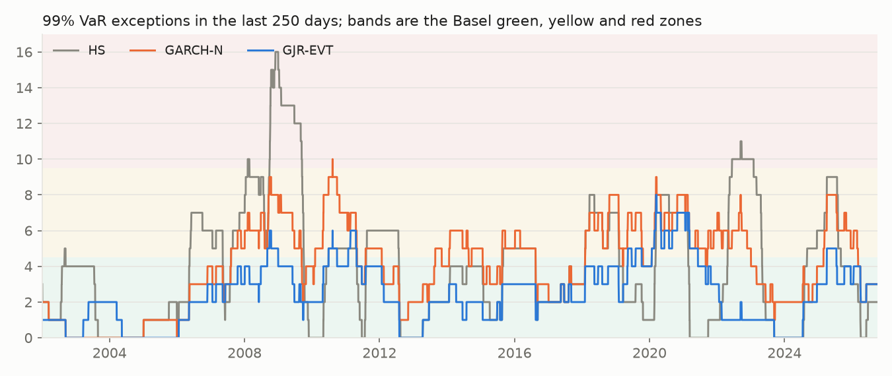

# Which VaR models survive an honest backtest?

[](https://github.com/rxj0102/Portfolio-VaR/actions/workflows/ci.yml)

**Question.** Ten standard ways of computing a 99% one day Value-at-Risk for a multi-asset portfolio, from historical simulation to GARCH with an extreme value tail. Each is re-estimated every month on past data only and scored on 25 years it has not seen. How many pass?

<!-- headline:start (generated by scripts/render_readme.py, do not edit by hand) -->
**Answer, over 6474 out-of-sample days from 2001 to 2026: one of ten, and none under a stricter timing test.** Only GJR-GARCH-t passes all three Christoffersen tests (75 violations against 65 expected). The Dynamic Quantile test of Engle and Manganelli, which asks whether a violation could be predicted from the last four days and the VaR level rather than from yesterday alone, rejects all ten at 5%, GJR-GARCH-t included (p = 0.010). Historical simulation, the simplest method, has 102 violations and spends 7% of days in the Basel red zone. Models that take the tail from past residuals (FHS-GJR, GJR-EVT) get the number of violations right but not their timing: the violations still cluster. For expected shortfall the order reverses. GARCH-t, GJR-GARCH-t, EGARCH-t understate it (t = 3.1, 2.5, 3.0), while the residual-based models do not.

**The same models fitted once on the whole sample look better than they are.** That shortcut passes 3 models instead of 1 and shows fewer violations for 7 of 7: FHS-GARCH drops from 83 to 64, because its tail quantile has already seen 2008 and 2020.
<!-- headline:end -->

Every number on this page is written by `scripts/reproduce.py`, and CI fails if the page and the results file disagree.



## Results

<!-- results:start (generated by scripts/render_readme.py, do not edit by hand) -->
Portfolio returns 2001-01-02 to 2026-09-30 (6474 days, 64.7 violations expected at 99%). Every model is re-estimated every 21 trading days (309 times) on all earlier returns; the first fit uses 1830 days from 1993-10-04. Annual volatility 16.7%, skewness -0.06, excess kurtosis 7.9.

**Out-of-sample backtest, 99% one day VaR**

| Model | Violations | Rate | Coverage p | Independence p | Joint p | Verdict | DQ p | In 90% MCS | Days green / yellow / red |
|---|---|---|---|---|---|---|---|---|---|
| HS | 102 | 1.58% | <0.001 | <0.001 | <0.001 | Fails POF, IND, CC | <0.001 | no | 60% / 33% / 7% |
| EWMA-N | 121 | 1.87% | <0.001 | 0.108 | <0.001 | Fails POF, CC | <0.001 | no | 43% / 54% / 3% |
| GARCH-N | 102 | 1.58% | <0.001 | 0.105 | <0.001 | Fails POF, CC | <0.001 | yes | 53% / 47% / 0% |
| GARCH-t | 79 | 1.22% | 0.085 | 0.018 | 0.014 | Fails IND, CC | <0.001 | yes | 75% / 25% / 0% |
| GJR-GARCH-t | 75 | 1.16% | 0.211 | 0.069 | 0.088 | **Pass** | 0.010 | yes | 81% / 19% / 0% |
| EGARCH-t | 79 | 1.22% | 0.085 | 0.018 | 0.014 | Fails IND, CC | <0.001 | yes | 77% / 23% / 0% |
| FHS-EWMA | 83 | 1.28% | 0.029 | 0.026 | 0.008 | Fails POF, IND, CC | <0.001 | yes | 84% / 16% / 0% |
| FHS-GARCH | 83 | 1.28% | 0.029 | 0.026 | 0.008 | Fails POF, IND, CC | <0.001 | yes | 72% / 28% / 0% |
| FHS-GJR | 70 | 1.08% | 0.517 | 0.048 | 0.114 | Fails IND | 0.010 | yes | 81% / 19% / 0% |
| GJR-EVT | 62 | 0.96% | 0.730 | 0.024 | 0.074 | Fails IND | 0.018 | yes | 89% / 11% / 0% |

Coverage is the Kupiec test, independence and joint are Christoffersen's; a p-value below 0.05 fails; the verdict uses these three. DQ is the Dynamic Quantile test (Engle and Manganelli 2004): a regression of the hit on a constant, four lagged hits and the VaR forecast, chi-squared with 6 degrees of freedom. MCS is the Model Confidence Set on quantile loss. The zones count exceptions in the previous 250 days: green up to 4, yellow 5 to 9, red 10 or more.

**Expected shortfall** (McNeil-Frey test; positive t means losses beyond VaR were larger than the model's ES; FZ0 is the joint VaR and ES loss of Patton, Ziegel and Chen, lower is better)

| Model | t | p | FZ0 loss | In 90% MCS on FZ0 |
|---|---|---|---|---|
| GARCH-t | +3.09 | 0.003 | -3.5040 | yes |
| GJR-GARCH-t | +2.50 | 0.015 | -3.5463 | yes |
| EGARCH-t | +3.01 | 0.004 | -3.5219 | yes |
| FHS-GARCH | +0.32 | 0.751 | -3.5246 | yes |
| FHS-GJR | +0.98 | 0.333 | -3.5564 | yes |
| GJR-EVT | +1.50 | 0.140 | -3.5560 | yes |

Expected shortfall has no loss function of its own, but VaR and ES together do (Fissler and Ziegel 2016), so the FZ0 loss ranks the models on both at once. FHS-GJR has the lowest, but the Model Confidence Set keeps all 6: on joint VaR and ES accuracy the data cannot separate them.

**The in-sample shortcut**: each model fitted once on the whole sample, then scored on the same days

| Model | Violations, out of sample | Violations, shortcut | Verdict, out of sample | Verdict, shortcut |
|---|---|---|---|---|
| GARCH-N | 102 | 101 | Fails POF, CC | Fails POF, CC |
| GARCH-t | 79 | 74 | Fails IND, CC | Fails IND, CC |
| GJR-GARCH-t | 75 | 74 | Pass | Pass |
| EGARCH-t | 79 | 78 | Fails IND, CC | Pass |
| FHS-GARCH | 83 | 64 | Fails POF, IND, CC | Fails IND, CC |
| FHS-GJR | 70 | 65 | Fails IND | Fails IND |
| GJR-EVT | 62 | 56 | Fails IND | Pass |

**Violation rate by period** (target 1.00%)

| Model | 2001-2006 (1507 d) | 2007-2009 (756 d) | 2010-2019 (2516 d) | 2020 (253 d) | 2021-2026 (1442 d) |
|---|---|---|---|---|---|
| HS | 1.00% | 3.04% | 1.39% | 2.77% | 1.53% |
| EWMA-N | 0.53% | 2.38% | 2.27% | 4.35% | 1.87% |
| GARCH-N | 0.46% | 2.25% | 1.83% | 3.16% | 1.66% |
| GARCH-t | 0.40% | 1.46% | 1.47% | 3.16% | 1.18% |
| GJR-GARCH-t | 0.40% | 1.46% | 1.23% | 2.77% | 1.39% |
| EGARCH-t | 0.40% | 1.85% | 1.39% | 3.16% | 1.11% |
| FHS-EWMA | 1.39% | 1.32% | 1.27% | 1.19% | 1.18% |
| FHS-GARCH | 0.53% | 2.12% | 1.47% | 3.16% | 0.97% |
| FHS-GJR | 0.53% | 1.46% | 1.19% | 2.77% | 0.97% |
| GJR-EVT | 0.40% | 1.32% | 1.07% | 2.77% | 0.83% |

**Where the risk sits.** Delta-normal 99% VaR is 2.45% with the covariance of the whole backtest window and 4.40% with the covariance of 2008-01-02 to 2009-06-30 (377 days). Shares of that VaR:

| Asset | Weight | Share, whole window | Share, 2008 to mid 2009 |
|---|---|---|---|
| SPY | 39% | 43% | 49% |
| QQQ | 33% | 49% | 43% |
| EFA | 17% | 10% | 11% |
| TLT | 11% | -2% | -2% |
<!-- results:end -->

## Reading the results

- **Asymmetry matters more than the tail distribution.** GARCH with Student-t errors fails; the same model with one more parameter, letting losses raise volatility more than gains do, passes. The same was true of the semi-parametric models: the GJR filter beats the GARCH filter.
- **Getting the count right is easier than getting the timing right.** Five models have an acceptable number of violations. Only one also spreads them out. A model whose violations cluster is the one that fails you three days running in a crisis. The Dynamic Quantile test makes the point harder: once the last four days and the VaR level are allowed to predict a violation, even the one model that spreads them out at lag one fails. Its violations are predictable from information it already had.
- **VaR and expected shortfall rank the models differently.** The one model that passes as a VaR model is a Student-t model, and the Student-t models are the worst for expected shortfall: once a loss passes their VaR it is larger than they say. Taking the tail from the residuals themselves fixes the shortfall and costs some independence. Regulation has moved from VaR to expected shortfall, so this is the comparison that matters more now.
- **Almost every model fails in 2020, and the GARCH-based models are too cautious in 2001 to 2006.** The first is a volatility jump no daily recursion follows. The second is a model trained on the dot-com years forecasting a calmer market.
- **The Model Confidence Set cannot separate the serious models.** It drops only the two crudest. Quantile loss differences between reasonable VaR models are small next to their noise, even in 25 years. Scoring VaR and expected shortfall together with the FZ0 loss does not help: every model with an ES forecast stays in the set.
- **The shortcut flatters the models with the most estimated tail.** Fitting once on the whole sample barely changes the parametric models and noticeably helps the ones whose tail quantile is estimated from residuals, because those residuals include the crises being forecast.

## Design

| Choice | What and why |
|---|---|
| Portfolio | Fixed weights, rebalanced daily: US equities 39%, NASDAQ 100 33%, developed markets ex US 17%, 20 year Treasuries 11%. |
| Forecast | One day ahead, 99%. The volatility for day t uses returns up to day t-1. |
| Estimation | Expanding window, re-estimated every 21 trading days. Parameters, residual quantiles and tail fits are held fixed between fits. |
| Models | Historical simulation (250 days); EWMA with normal quantile; GARCH normal and Student-t; GJR-GARCH and EGARCH Student-t; filtered historical simulation with EWMA, GARCH and GJR filters; GJR with a generalised Pareto tail above the 90th percentile of residual losses. |
| Tests | Kupiec coverage, Christoffersen independence and joint; Engle-Manganelli Dynamic Quantile; McNeil-Frey for expected shortfall; Model Confidence Set on quantile loss and, for the ES models, on the FZ0 joint loss; Basel traffic-light zones. |
| Tuning | None. Every setting was fixed before the run. The Dynamic Quantile test (four lags, the textbook choice) and the FZ0 ranking were added after the first results were published, following a literature review; neither changes a forecast. |

## What was wrong with the first version

It fitted each model once on the whole sample and backtested it on that same sample. A VaR backtest done that way knows the future: the parameters, the degrees of freedom and above all the tail quantiles had already seen every crisis they were then tested on. The comparison table above shows what that was worth. The first version also carried two errors in the Student-t quantile and the volatility lag, fixed earlier, and thirteen models where several differed only in ways the data could not distinguish.

## Limits

- One portfolio with fixed weights. The assets are open data stand-ins: the Ken French US and developed ex US market returns, the NASDAQ 100 price index from FRED, and a 20 year Treasury par bond priced from the FRED yield.
- One day horizon and one confidence level. Regulatory capital uses ten days and, under the current rules, expected shortfall at 97.5%. The expected shortfall backtests of Acerbi and Szekely (2014), built for that level, are not run.
- Christoffersen's independence test looks at lag one only; the Dynamic Quantile test adds four lags and the VaR level. Neither is a test for clustering at monthly horizons.
- The component VaR table is descriptive and uses the whole window's covariance. It is not a forecast.
- 65 expected violations is a small sample for a tail test, so a pass is weaker evidence than a fail.

## Reproduce

```bash
pip install -r requirements.txt
python -m pytest -q               # tests
python scripts/reproduce.py       # about a minute, rewrites results/
python scripts/render_readme.py   # rewrites this page; --check compares only
```

Returns are frozen in `data/snapshot/asset_returns.csv`. `src/opendata.py` rebuilds them from FRED and the Ken French Data Library.

## Layout

```
src/walkforward.py   out-of-sample VaR and ES for every model, the in-sample shortcut, Basel zones
src/garch_var.py     quantile and ES multipliers for unit-variance normal and Student-t
src/metrics.py       Kupiec, Christoffersen, McNeil-Frey, Model Confidence Set
src/opendata.py      FRED and Ken French loaders, bond pricing from yields
scripts/             reproduce.py writes results/, render_readme.py writes this page
tests/               look-ahead checks and tests of each statistic against known answers
```

## References

- Acerbi, C. and Szekely, B. (2014). Backtesting expected shortfall. *Risk*, December.
- Basel Committee on Banking Supervision (1996). Supervisory framework for the use of backtesting in conjunction with the internal models approach to market risk capital requirements.
- Barone-Adesi, G., Giannopoulos, K. and Vosper, L. (1999). VaR without correlations for portfolios of derivative securities. *Journal of Futures Markets* 19(5).
- Christoffersen, P. (1998). Evaluating interval forecasts. *International Economic Review* 39(4).
- Engle, R. and Manganelli, S. (2004). CAViaR: conditional autoregressive value at risk by regression quantiles. *Journal of Business and Economic Statistics* 22(4).
- Fissler, T. and Ziegel, J. (2016). Higher order elicitability and Osband's principle. *Annals of Statistics* 44(4).
- Glosten, L., Jagannathan, R. and Runkle, D. (1993). On the relation between the expected value and the volatility of the nominal excess return on stocks. *Journal of Finance* 48(5).
- Hansen, P., Lunde, A. and Nason, J. (2011). The model confidence set. *Econometrica* 79(2).
- Kupiec, P. (1995). Techniques for verifying the accuracy of risk measurement models. *Journal of Derivatives* 3(2).
- McNeil, A. and Frey, R. (2000). Estimation of tail-related risk measures for heteroscedastic financial time series. *Journal of Empirical Finance* 7(3).
- Patton, A., Ziegel, J. and Chen, R. (2019). Dynamic semiparametric models for expected shortfall (and Value-at-Risk). *Journal of Econometrics* 211(2).
